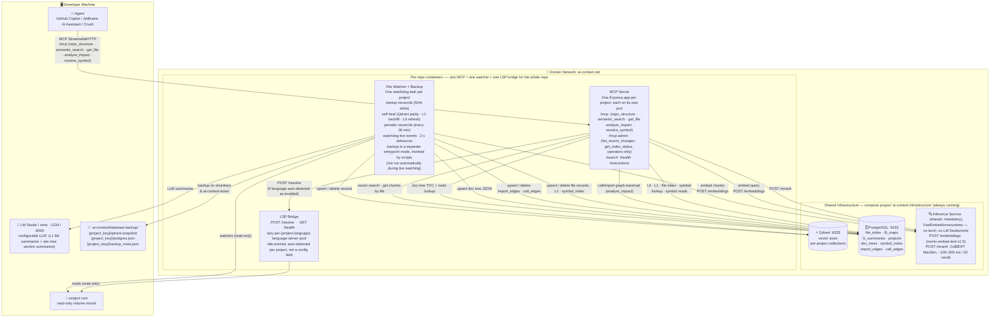
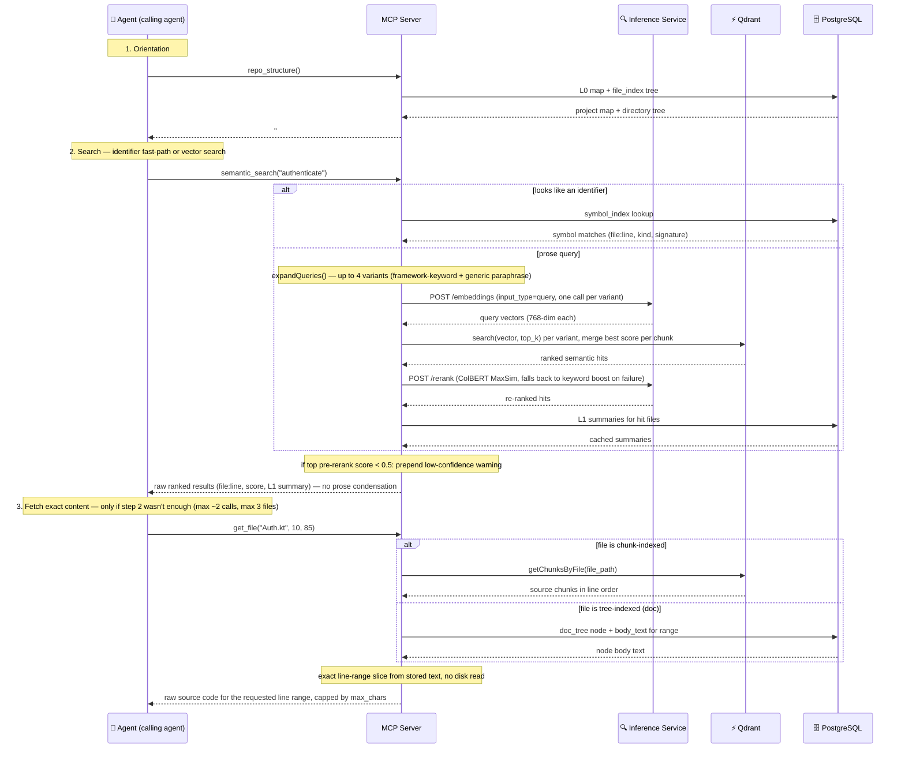

# Architecture Deep-Dive

The reference/prose companion to this project's interactive `docs/*.html`
diagrams — this doc preserves the exact design rationale and mechanics in
searchable text form; the HTML docs give you the visual/interactive
walkthrough of the same territory. See each section's "See also" pointer.

For the top-level architecture diagram and elevator-pitch summary, see the
main [`README.md`](../README.md#architecture).

> **`sst/opencode` users:** everything below describes this repo's
> Docker-based stack (Postgres + Qdrant + inference service + per-project
> MCP/watcher/LSP-bridge containers) — now the opt-in "heavy mode" for very
> large repos or non-`sst/opencode` agents. For typical repo sizes,
> **[`opencode-ai-context-plugin/`](../../opencode-ai-context-plugin/)** is a
> native `sst/opencode` plugin covering the same retrieval-layer idea
> (chunking, embedding, vector search) as a single in-process SQLite store
> with no containers at all — see its own
> [`README.md`](../../opencode-ai-context-plugin/README.md#design-choices-worth-calling-out)
> and [`docs/adr/`](../../opencode-ai-context-plugin/docs/adr/) for how each
> piece maps to (and deliberately diverges from) the architecture described
> here.

---

## Retrieval layers

*See also: [`interactive/overview.html`](interactive/overview.html) §5 "The Three Retrieval Layers" for a visual walkthrough.*

Context is assembled from three named layers of increasing detail:

| Layer | Name | Storage | Content |
|-------|------|---------|---------|
| **L0** | **Project Map** | PostgreSQL `l0_maps` | Static structure map — modules, entry points, key files. Generated once; no LLM. Served by `repo_structure`. |
| **L1** | **File Summaries** | PostgreSQL `l1_summaries` | LLM-generated 4–6 sentence technical summary per file. Content-SHA-keyed cache. Included in `semantic_search` results. |
| **L2** | **Code Chunks** | Qdrant (vector store) | AST-boundary-chunked source code segments with dense embeddings. Retrieved via semantic search + ColBERT re-ranking (default, always attempted) or term-frequency keyword boost (fallback only on a transient inference-service failure). Full chunk text served by `get_file`, sliced to exact line ranges from the stored payload. |

Cross-project `sources` mode strings (`l0`, `l0+l1`, `l0+l1+l2`) are validated and stored per source entry, but are currently only consumed by `assembleContext()` in `context_assembler.ts` — a function not wired to any live route (`semantic_search` and `/search` both use `rankedSemanticSearch`, which ignores `sources` entirely). The `mode` field is effectively inert in the running system today; cross-project awareness works instead via agent-driven guidance in the skill file.

---

## Architecture diagram — running state

*See also: [`interactive/infrastructure.html`](interactive/infrastructure.html) for the interactive container/topology map.*

Everything that exists once `mise run ai-context-infra-up` and `mise run ai-context-up` have completed:



---

## Query flow — how the agent drives its own retrieval loop

*See also: [`interactive/overview.html`](interactive/overview.html) §6 "A Query From Start to Finish" and [`interactive/sequences.html`](interactive/sequences.html) for interactive sequence diagrams.*



---

## MCP Manifest Design Decisions

The MCP tool manifest is serialised on **every `listTools` call** — the assistant pays its token cost before any retrieval even starts. These decisions keep that cost minimal.

### A — Minimal `/mcp` manifest — 5 tools only

`/mcp` exposes exactly **5 tools** — `repo_structure`, `semantic_search`, `get_file`, `analyze_impact`, `resolve_symbol`. The calling agent drives all retrieval itself; there is nothing else it needs on that endpoint. `analyze_impact` was added deliberately as its own explicitly-invoked tool (not folded into `get_file`/`semantic_search`) so the agent can call it before a risky edit without changing the behavior of the other three — see "Call & Import Graph" below. Two operator-only diagnostics (`list_recent_changes`, `get_index_status`) live on a separate `/mcp-admin` endpoint, not in the agent-facing manifest.

**`resolve_symbol`** (see [LSP Integration](lsp-integration.md)): added later following the same principle — explicitly invoked only when the agent needs compiler-grade certainty (real LSP `definition`/`references`/`hover`) that the heuristic `analyze_impact` call graph can't provide. **Auto-detected per project/language, same as `profile`** — `lsp.enabled_languages` is derived from the project's own files at validate time and is **not** a `config.yaml` field; setting it by hand is a validation error (see `scripts/validate_config.py`). The tool itself always exists on `/mcp`, but returns a plain-text explanation instead of results if the language isn't auto-detected/enabled for that project.

**Endpoint enforcement:** The server rejects `CallTool` requests for any tool not listed in the endpoint's manifest — a request for an admin tool on `/mcp`, or vice versa, returns an error. This is enforced at the call level, not just by hiding tools from `listTools`, so a client cannot bypass the split by calling a tool directly by name.

### B — Tightened schemas prevent invalid calls

`list_recent_changes.limit` is declared `{ type: "integer", minimum: 1, maximum: 200, default: 10 }` and is runtime-clamped to those bounds. Out-of-range values (e.g. `-5`, `99999`) are silently corrected instead of causing tool errors and retries. Fewer failed calls = fewer tokens.

### C — Output caps on large-response tools

| Tool | Parameter | Default | Purpose |
|------|-----------|---------|---------|
| `get_file` | `max_chars` | 50 000 | Prevent huge files from flooding the context window |
| `repo_structure` | `depth` | 2 | Prevent thousands-of-lines directory dumps; deeper paths collapse into a depth-capped summary line |

Both caps are optional schema fields — default behaviour is unchanged unless explicitly passed.

### D — Empty tool descriptions + instructions via MCP handshake

All tools have `description: ""`. Tool-selection guidance is delivered through three channels instead:

1. **MCP `initialize` response** — the `instructions` field (MCP spec 2025-03-26, SDK 1.29+) carries a short pointer + tool guide to any compliant client (e.g. GitHub Copilot, Crush) automatically during the connection handshake. No extra tool call needed.
2. **Skill file** — `.ai-context/skills/ai-context-workflow/SKILL.md` (generated by `scripts/init_ide.sh`) carries the full call-order/iteration-cap/stop-rule guidance for agents that support skill discovery.
3. **`GET /instructions`** REST endpoint — same handshake content, for humans and scripts.

Duplicating guidance in the manifest descriptions costs tokens on every `listTools` call. The handshake and skill file deliver it once per session/trigger instead.

If tool-selection quality drops, add 2–5 word descriptions — the schema supports it without any other changes.

### E — Directory auto-detect hint

When `get_file` is called on a directory path it includes a ready-to-use suggestion:
`Next: call \`repo_structure\` with dir_path="<same path>"`
This eliminates the follow-up round-trip where the assistant figures out the correct next call.

---

## Earlier Design: Routing LLM (Removed)

An earlier iteration explored routing all retrieval through a local LLM sitting between the calling agent and the retrieval backend: the agent called a minimal 2-tool gateway, and a second, local model ran its own bounded tool loop against Qdrant/PostgreSQL directly, then returned a condensed summary instead of raw results.

This was removed after it turned out to only add overhead without improving results: an extra local-inference round-trip on every query, a condensation pass that discarded information the calling agent might have needed, and a layer where hallucination/paraphrasing could creep in unverified. Modern coding agents already do multi-step tool orchestration natively and reliably, so hiding retrieval behind a second model no longer had a justification. The current direct 3-tool surface (`repo_structure` / `semantic_search` / `get_file`) replaced it — see [`benchmark/benchmark-results.md`](benchmark/benchmark-results.md) for measured results confirming the direct approach performs at least as well, without the added overhead.

> **Note on the CLI `/search` endpoint:** `GET/POST /search` on the MCP server is a thin debug/CLI wrapper over the same `rankedSemanticSearch()` `semantic_search` uses (single project only, plain-text ranked hits) — not part of the agent-facing surface. It does **not** assemble L0+L1+L2 context the way `assembleContext()` would; see "Retrieval layers" above for why that function isn't on a live route today.

---

## Re-ranking

*See also: [`interactive/context-map.html`](interactive/context-map.html) for the interactive retrieval-pipeline explorer.*

After Qdrant returns semantic hits, re-ranking improves result quality before file grouping. Two complementary mechanisms are available:

### Keyword boost (fallback, only on a transient inference-service failure)

Vector similarity alone can under-rank exact identifiers — class names like `PlatformUserRepository`, annotations like `@KoinComponent`, or Gradle dependency keys. After Qdrant returns hits, a lightweight keyword pass is applied:

1. **Term extraction** — the raw query is tokenised on non-word chars; camelCase identifiers are split into sub-tokens (`PlatformUserRepository` → `platform`, `user`, `repository`).
2. **Keyword scoring** — for each hit, count how many times query terms appear in the chunk text; normalise to [0, 1] (capped at 10 occurrences = 1.0).
3. **Score blending** — `final_score = 0.75 × semantic_score + 0.25 × keyword_score`.
4. Re-sort by combined score before file grouping.

No schema changes, no Qdrant sparse-vector indexing, no additional embedding calls. This is no longer a user-facing config toggle — `crossEncoderRerank()` (`context_assembler.ts`) always attempts a real re-rank call first and only falls back to this on a caught exception (network error, service briefly restarting), so it's a resilience safety net, not a "disable re-ranking" switch.

### ColBERT re-ranker (default, always attempted)

The shared, mandatory **inference service** (`ai_context_inference` — see "Embedding service" below, same container that generates embeddings) replaces the keyword boost with token-level re-ranking via ColBERT, implemented using **FastEmbed**'s `LateInteractionTextEmbedding` plus a small hand-rolled MaxSim scoring function (`inference/maxsim.py` — FastEmbed provides per-token embeddings but, unlike the PyLate library this replaced, no built-in rerank/scoring utility). ColBERT keeps **per-token embeddings** for both query and document and computes **MaxSim** — directly matching tokens like `PlatformUserRepository` or `@KoinComponent` without losing them in a single dense vector.

| Backend | Library | Model | Size | Latency (20 cands) | Best for |
|---------|---------|-------|------|---------------------|----------|
| `colbert` **(default)** | FastEmbed | `answerdotai/answerai-colbert-small-v1` | ~130 MB | ~100–300 ms | Code search — token-level MaxSim |
| `cross-encoder` | FastEmbed | `Xenova/ms-marco-MiniLM-L-6-v2` | ~90 MB | ~5–50 ms | Fast fallback, prose-heavy repos |

Backend/model choice is fixed at **Docker build time** (`RERANKER_BACKEND`/`RERANKER_MODEL` build ARGs in `inference/Dockerfile`), not a `config.yaml` field — see "Embedding service" below for why config.yaml no longer carries model/provider choices for either endpoint. To switch backend, rebuild the image:

```bash
docker build --build-arg RERANKER_BACKEND=cross-encoder -t ai-context-inference:latest .ai-context/inference
```

Both backends now share the exact same dependency (`fastembed`/`onnxruntime`) — unlike the previous PyLate-vs-sentence-transformers split (which needed a multi-GB CPU `torch` build for PyLate and a separate, incompatible arm64 workaround), so keeping both available costs little in image size or build complexity.

Container: `ai_context_inference` — one shared instance (embeddings + re-ranking together), CPU-only, no torch — meaningfully lighter than the former standalone `ai_context_reranker` container's ~700 MB PyLate/torch footprint.

---

## Embedding service

*See also: [`interactive/infrastructure.html`](interactive/infrastructure.html).*

Embeddings are generated by the same shared `ai_context_inference` container as re-ranking (`POST /embeddings`, backed by FastEmbed's `TextEmbedding("nomic-ai/nomic-embed-text-v1.5-Q")`) — mandatory, always-on infra alongside Qdrant/PostgreSQL, not an external LM Studio/omlx/ollama process the way the LLM (L1 summaries) still is.

The model is **hardcoded**, not a `config.yaml` field, for a reason specific to embeddings: the vector dimension (768) is baked into every project's Qdrant collection schema at creation time. Changing the embedding model is a data-migration decision (`mise run ai-context-reset`), not a config toggle — exposing it as a freely-editable YAML value would make "I changed `embedding.model` but forgot to reset" an easy, silent-corruption footgun. Removing the field removes the footgun.

The request distinguishes query-time from index-time embedding via an `input_type` field (`"query"` or `"document"`), so the service can apply nomic-embed-text's required task prefix (`"search_query: "` / `"search_document: "`) correctly per call — the previous raw OpenAI-API passthrough to LM Studio/omlx never applied either prefix, a real (if minor) retrieval-quality gap this migration also happened to close.

---

## Query expansion & low-confidence signal

*See also: [`interactive/context-map.html`](interactive/context-map.html).*

Before vector search runs, `expandQueries()` (`mcp-server/src/context_assembler.ts`) generates additional query variants — the resulting hits from every variant are merged by chunk (keeping the best score seen for each), so a single call to `semantic_search` effectively searches several phrasings at once:

- **Framework-keyword expansion** (profile-scoped) — appends framework-specific terms when the query and the project's `profile` match, e.g. Koin/Ktor terms for `kotlin-backend`, Spring/JPA terms for `java-backend`, React/Angular/Vue terms for frontend profiles.
- **Generic lexical paraphrase** (unconditional, runs regardless of profile) — two mechanisms, both aimed at not losing a match purely to wording:
  - *Synonym substitution* for a small, fixed set of common code-question verbs: `decide`/`determine`/`compute`, `configure`/`set up`, `route`/`dispatch`, `write`/`persist`/`store`.
  - *Reordering* — a "How does X do Y" question also tries "Y X" / "X Y implementation" as a variant, since two phrasings of the same question often differ mainly in word order.

Total variants (original + framework + generic) are capped at **4** per `semantic_search` call, to bound the number of embedding calls.

**Low-confidence signal:** if the *best pre-rerank* vector score across all variants is below `LOW_CONFIDENCE_THRESHOLD` (`0.5`), the response is prepended with a one-line notice: `⚠ No strong match (top score X.XX) — results below may be irrelevant. Consider rephrasing or checking whether this was removed/renamed.` The ranked hits themselves are never suppressed — this is a signal to the calling agent, not a filter. The threshold deliberately checks the score *before* re-ranking: a re-ranker's own score scale (e.g. ColBERT MaxSim, unbounded) is not comparable to Qdrant's 0–1 cosine similarity, so using the post-rerank score here would make the signal meaningless once a re-ranker is active.

---

## Symbol Index (AST extraction + chunker fallback)

*See also: [`interactive/context-map.html`](interactive/context-map.html).*

Symbols (classes, functions, interfaces, methods, …) are extracted from source files and stored in the `symbol_index` PostgreSQL table via two complementary paths:

1. **Tree-sitter AST parsing** — Python, TypeScript, TSX, JavaScript, Java, Kotlin, C#, Swift (via `tree-sitter-languages`). This is the primary, most precise path for these 8 languages.
2. **Chunker-derived fallback** — for every other file type the chunker already understands structurally (Vue SFCs, SQL, YAML/TOML, Markdown), symbols are derived directly from the chunker's own boundary metadata instead (`watcher/indexer.py`'s `_fallback_symbols_from_chunks()`) — no tree-sitter grammar needed. This also applies, **regardless of language**, to dispatch-arm chunks (see "Structure-aware chunking" below): a switch/when/match arm has no tree-sitter node type of its own in any language, so its `symbol_index` row always comes from this fallback path, even in a fully tree-sitter-supported file.

| Column | Description |
|--------|-------------|
| `file_path` | Source file relative path |
| `symbol_name` | Class / function / interface name |
| `symbol_kind` | Tree-sitter path: `class`, `function`, `interface`, `method`, `enum`, … . Chunker-fallback path: `table`/`view`/`index`/`function`/`procedure`/`trigger` (SQL, parsed from the `CREATE` statement), `heading` (Markdown), `component`/`function`/`block` (Vue SFC tags), `block` (YAML/TOML top-level key), or `case` (a dispatch arm, any language). These two sources use different, non-overlapping vocabularies — don't assume `symbol_kind` is drawn from one fixed enum. |
| `parent_symbol` | Enclosing class (for methods); always `NULL` for chunker-fallback rows (the chunker doesn't track nesting) |
| `signature` | Full signature string (tree-sitter path) or the chunk's own first line as a best-effort signature (chunker-fallback path) |
| `start_line` / `end_line` | Location in source file |
| `chunk_id` | Foreign key to the Qdrant chunk |

`semantic_search`'s identifier fast-path queries this table directly to resolve specific identifiers (e.g. `PlatformUserRepository`, `authenticate`, an exact SQL table name, or a `case` label like `get_index_status`) without a full semantic search — fast and precise. Prose-style queries fall back to vector search automatically.

---

## Call & Import Graph + `analyze_impact` (blast-radius) tool

*See also: [`interactive/context-map.html`](interactive/context-map.html).*

Two additional PostgreSQL tables, populated alongside `symbol_index` on every reindex, give the agent a **structural** (not embedding-based) view of how files and symbols depend on each other.

| Table | Populated by | Content |
|-------|--------------|---------|
| `import_edges` | `watcher/import_extractor.py` | One row per `import`/`using`/`require` statement (Python, TS/TSX/JS, Java, C#, Kotlin, Swift). `resolved_file` is filled in with best-effort resolution against already-indexed files; `NULL` means an external/library import (still recorded, never a graph edge). |
| `call_edges` | `watcher/symbol_extractor.py`'s `extract_symbols_and_calls()` | One row per call-expression found while walking the same tree-sitter AST already built for symbol extraction (no re-parse). Each edge records `(caller_symbol_id, callee_name, callee_symbol_id, resolution, call_line)`. |

**Name-based resolution only** (deliberately *not* full type/overload resolution — that is exactly the gap a real LSP would close, see [LSP Integration](lsp-integration.md)):
1. Same-file match in `symbol_index` first (highest precision).
2. Else, look across files reachable via this file's `import_edges.resolved_file` — exactly one candidate → `resolution = 'exact'`; more than one → `resolution = 'ambiguous'` (no per-candidate rows stored; the traversal tool re-queries by name on demand instead).
3. Else → `resolution = 'unresolved'` (built-in, external library, or dynamic dispatch).

**`analyze_impact(symbol_name, [file_path], direction, [depth], [include_tests])`** — a 4th agent-facing MCP tool built on these two tables:

```
analyze_impact(symbol_name, file_path?, direction, depth?, include_tests?)
  direction: "callers" | "callees" | "both"     (required)
  depth:     1..5, default 1                     (bounds response size/token cost)
  include_tests: bool, default true
```

- Returns direct callers/callees (BFS up to `depth` hops), any ambiguous call targets with their name-matched candidates, and a heuristic list of co-located test files that import or call the symbol — plus a one-line `blast_radius_summary`.
- If `symbol_name` matches more than one symbol in the project, the tool returns a disambiguation message listing `file:line` candidates instead of guessing — pass `file_path` to disambiguate.
- Pass `file_path` when the target symbol name isn't unique in the project.

### Provenance ("why") trace on `semantic_search`

Every `semantic_search` hit now carries a `why` note explaining how it scored, so the agent (and a human reading the output) can judge trustworthiness instead of trusting a bare number:

- Identifier fast-path: `matched identifier 'X' directly (symbol_index fast-path)`.
- Vector hits: `vector similarity 0.71, keyword boost +0.12` (keyword-blend fallback path), or `cross-encoder rerank score 0.83 (pre-rank vector similarity 0.71)` when the inference service's re-rank call succeeds (the default, always-attempted path).

This is a near-zero-cost addition to the existing scoring path in `context_assembler.ts` — no new query, no graph dependency; it covers vector/keyword hits exactly as much as any future graph-assisted hits.

### Structural roles on `repo_structure`

Per-file entries in `repo_structure`'s directory tree may carry a `[hub]` or `[bridge]` tag, computed purely from `import_edges`/`call_edges` in-/out-degree — no embeddings, no LLM call:

- **`hub`** — in-degree (importers/callers) in the top 10% for the project. Worth extra care before changing; many other files depend on it.
- **`bridge`** — has both incoming and outgoing edges without being a hub — a simple "connector" proxy, deliberately **not** full betweenness/community detection (that's a real algorithmic addition to revisit only if this coarser signal proves insufficient).
- Untagged files are leaves (no incoming edges) or ordinary nodes — the tag is omitted rather than spelled out for every file, to keep the tree readable.
- Degrades silently (no tags, no error) if `import_edges`/`call_edges` aren't populated yet for the project.

---

## Structure-aware chunking

*See also: [`interactive/chunking.html`](interactive/chunking.html) for the interactive chunking-strategy explorer.*

The chunker dispatches by file extension to pick the most meaningful boundary strategy for each file type. `.java`, `.cs`, `.ts`, and `.tsx` use tree-sitter AST boundaries directly (`_chunk_by_treesitter()`, reusing `symbol_extractor`'s tree-sitter parser setup — no re-parse) for Tier-1 accuracy on container/decorator-heavy code (Java annotations, C# namespace nesting, Angular decorators); they fall back to the regex-based strategy below on parse failure (broken syntax), zero top-level nodes found, or if tree-sitter is unavailable. All other extensions use chunker's own regex patterns, not tree-sitter (tree-sitter is used separately for `symbol_index` population on 8 languages — see "Symbol Index" above):

For `.ts`/`.tsx`, `_find_decorator_start()` + `_apply_decorator_fix()` extend a decorated declaration's chunk boundary backward to include its Angular decorator (`@Component`, `@Injectable`, etc.) — otherwise the tree-sitter boundary alone would start *after* the decorator, separating a class from the metadata that describes it. `_CONTAINER_ONLY_NODE_TYPES` controls which tree-sitter node types (e.g. `namespace` in C#) are treated purely as containers to recurse into rather than chunk boundaries themselves — a namespace-collapse bug here (nested containers absorbing their children into one oversized chunk instead of recursing) was found and fixed during fixture testing.

| Extension | Chunking strategy |
|-----------|------------------|
| `.kt`, `.kts` | Kotlin boundaries: `class`, `object`, `fun`, `interface` |
| `.ts`, `.tsx` | **Tree-sitter boundaries** (Tier-1): `class`, `function`, `interface`, `type`, `enum`, arrow-fn, Angular decorator-attached declarations; falls back to regex (below) on parse failure |
| `.js`, `.jsx` | TypeScript/JS regex boundaries: `class`, `function`, `interface`, `type`, `enum`, `const` arrow-fn |
| `.py` | Python boundaries: `class`, `def` (top-level) |
| `.cs` | **Tree-sitter boundaries** (Tier-1): `class`, `interface`, `enum`, `struct`, `record`, `namespace` nesting; falls back to regex (below) on parse failure |
| `.java` | **Tree-sitter boundaries** (Tier-1): `class`, `interface`, `enum`, `record`, `@interface`, annotations; falls back to regex (below) on parse failure |
| `.swift` | Swift boundaries: `class`, `struct`, `enum`, `protocol`, `func`, `extension`, `actor` |
| `.go` | Go boundaries: `func` (including methods with a receiver), top-level `type` declarations |
| `.rs` | Rust boundaries: `fn`, `struct`, `enum`, `trait`, `impl` (top-level only) |
| `.rb` | Ruby boundaries: `class`, `module`, `def` (top-level only) |
| `.php` | PHP boundaries: `class`, `interface`, `trait`, `function` (top-level only) |
| `.c`, `.cc`, `.cpp`, `.cxx`, `.h`, `.hpp` | C/C++ boundaries: `struct`/`class`/`enum`/`union` declarations + function *definitions* (heuristic — least regular syntax handled here) |
| `.vue` | Vue SFC block boundaries: `<template>`, `<script>`, `<style>` |
| `.md` (small, < `min_headings_for_tree` headings) | Markdown heading boundaries → Qdrant |
| `.md` (large, ≥ `min_headings_for_tree` headings, or in `always_tree_paths`) | **PageIndex-style hierarchical tree → `doc_trees` PostgreSQL table** |
| `.sql` | SQL statement boundaries: `;` (consecutive short statements grouped); `CREATE TABLE/VIEW/INDEX/FUNCTION/PROCEDURE/TRIGGER` statements also get a symbol name |
| `.yaml`, `.yml`, `.toml` | Top-level key boundaries: non-indented `key:` / `key =` lines |
| Everything else | Blank-line paragraph chunker (max 80 lines) |

**Dispatch-arm sub-chunking (additional pass):** for TS/TSX/JS/JSX, Java, C#, Swift, Kotlin, and Python, a second pass looks *inside* each already-produced function/class chunk for a `switch`/`when`/`match` dispatch block. If it has **3 or more arms**, each arm is split into its own chunk (`chunk_type="case"`, `symbol` = the arm's label, e.g. `case "get_index_status":` → `get_index_status`) — independently searchable and identifier-resolvable, instead of being buried, invisible, inside the enclosing function's single chunk. Blocks with fewer than 3 arms are left as part of the enclosing chunk (not "dispatch-table style" code, not worth the extra chunk).

This ensures structure is preserved in config files, prose documentation, and scripts — not just code. Re-indexing is required to apply the new strategy to existing files (`mise run ai-context-reset`).

---

## File watcher event handling

*See also: [`interactive/infrastructure.html`](interactive/infrastructure.html), [`interactive/sequences.html`](interactive/sequences.html).*

The file watcher translates every filesystem event into a precise set of database operations — nothing more, nothing less:

| Event | Qdrant | PostgreSQL `file_index` | PostgreSQL `l1_summaries` | PostgreSQL `doc_trees` |
|---|---|---|---|---|
| **File created** | delete old points for path (no-op) → insert fresh vectors | upsert row (sha, chunk_count, timestamp) | insert if SHA not cached → call LLM | — (Qdrant mode) |
| **File saved / modified** | delete old points → insert fresh vectors | update sha, chunk_count, timestamp | reuse cached summary if SHA unchanged **and** L1 exists; call LLM if content changed **or** if previous L1 generation failed | — (Qdrant mode) |
| **File deleted** | delete all points for path | delete row | orphaned row left intentionally (SHA-keyed cache; reused if file is re-created with same content) | — (Qdrant mode) |
| **File renamed / moved** | delete old path points → insert new path vectors | delete old row → upsert new row | new L1 lookup for new path/SHA | — (Qdrant mode) |
| **File created (tree mode)** | no-op | upsert row (sha, chunk_count=0) | no L1 (tree mode) | **build + upsert tree** |
| **File saved / modified (tree mode)** | no-op | update sha | no L1 (tree mode) | **SHA check → rebuild if changed** |
| **File deleted (tree mode)** | no-op | delete row | no-op | **delete tree row** |
| **File renamed / moved (tree mode)** | no-op | delete + upsert | no-op | **delete old + build new** |

**SHA-based change detection & stable chunk IDs:** every save computes a SHA-256 hash of the file content. If the hash matches the stored `content_sha256` **and** the L1 summary already exists, the watcher returns immediately — no re-chunking, no re-embedding, no LLM call. Chunk IDs are stable `UUID v5` content hashes derived from `SHA256(project_key:relative_path:chunk_text)` — only changed/new chunks are re-embedded; unchanged chunks keep their ID with zero re-embedding cost. This means rapid successive saves (e.g. auto-formatter runs on save) result in exactly one re-index cycle. If the SHA matches but the L1 summary is absent (e.g. LM Studio was unavailable during initial indexing), the watcher will retry L1 generation without re-embedding the file.

**`CHUNKER_VERSION` and payload freshness:** `watcher/chunker.py` exposes `CHUNKER_VERSION` (currently `7`), bumped whenever `chunk_file()`'s boundary logic changes, to force a one-time repo-wide re-chunk of already-indexed files that would otherwise never see the new chunking (their source text hasn't changed, only how it *should* be split). A related bug was found and fixed in `upsert_chunks_delta()` (`watcher/db.py`): `stable_chunk_id()` hashes only chunk **text** (+ `start_line`), not `chunk_type`/`end_line`/`symbol` — so a re-chunk that only changes a chunk's *classification* or a neighbor's boundary, while its own text span stays byte-identical, produced the same point ID as before and was silently skipped, leaving stale `chunk_type`/boundary metadata in Qdrant indefinitely. Fixed by having `upsert_chunks_delta()` also call `qd().set_payload(...)` (cheap, no re-embedding) for every text-unchanged point on each re-chunk.

**Debounce:** events are held for `debounce_seconds` (default 2 s) and coalesced. Rapid edits are batched into a single indexing run.

**Eligibility filter:** the watcher and the full-index scan now share a single exclusion function (`indexer.should_skip()`, imported by both — they previously duplicated this logic independently and had drifted out of sync) that checks, in order: the hardcoded noise dirs/patterns (`build/`, `node_modules/`, `.gradle/`, `.git/`, `.ai-context/`, `dist/`, `out/`, `target/`, `__pycache__/`, `.idea/`, `.vscode/`, `.kotlin/`, `generated/`, `generated-sources/`, `*.class`, `*.jar`, `*.lock` — always applied, every project, cannot be disabled), the merged `.gitignore` rules (see below), and the config `extra_skip_paths` list (`shared.indexer.extra_skip_paths`, plus any per-project `projects[].indexer.extra_skip_paths` additions — see `config.yaml`'s comment on `extra_skip_paths` for the override syntax). Use `extra_skip_paths` for anything that shouldn't be searchable *or backed up* — generated artifacts, vendored code, or paths with sensitive/unnecessary data; excluding a path here means it's never indexed, so `mise run ai-context-backup` never sees it either (backup mirrors whatever was indexed, with no separate backup-time filter). A project's own configured `backup_output_dir` is additionally auto-excluded whenever it falls inside that project's `root_path`, so a project can never accidentally index/search its own backup dumps.

**Gitignore handling:** by default, each project reads `.gitignore` from the top level of its own `root_path` (via `pathspec`, gitwildmatch semantics) — this is always on and needs no configuration. `shared.indexer.extra_gitignore_paths` (plus a per-project `projects[].indexer.extra_gitignore_paths` addition) lets you merge in more `.gitignore`-format files, and — unlike `extra_skip_paths` — these files don't have to live inside the project's own `root_path`; a common case is one monorepo-top-level `.gitignore` shared by several project subdirectories. Since the consolidated watcher container bind-mounts every project root at a distinct container path, `scripts/start.sh` also bind-mounts every configured extra gitignore file individually into the container at a project-scoped path so it can still be read; `watcher/config_loader.py`'s `extra_gitignore_container_paths()` and `watcher/indexer.py`'s `load_gitignore()` handle the container-side reconstruction. All patterns (the project's own `.gitignore` plus every configured extra file) are merged into one rule set — a path is excluded if any one of them would exclude it. One caveat: a leading-`/` anchored pattern is normally relative to the directory of the `.gitignore` it came from; once merged, every pattern is matched relative to the *project's own* root instead, so an anchored pattern from an external file is reinterpreted relative to the project's root rather than that file's real location. Un-anchored patterns (the common case) are unaffected.

---

## Watcher self-healing configuration

*See also: [`interactive/infrastructure.html`](interactive/infrastructure.html).*

The following settings under `shared.indexer` control the watcher's self-healing and reconciliation behaviour:

```yaml
shared:
  indexer:
    debounce_seconds: 2              # debounce delay for live FS events
    reconcile_interval_minutes: 30   # periodic full delta scan (0 = disabled)
    polling_fallback_seconds: 10     # fallback-only polling watcher (0 = disabled) — see below
```

| Setting | Default | Description |
|---|---|---|
| `reconcile_interval_minutes` | `30` | How often the watcher re-scans all files against the DB while running. Catches changes missed by live FS events. Set to `0` to disable. |
| `polling_fallback_seconds` | `10` | Interval for a fallback polling-based watcher, running *alongside* the primary native one — never replacing it. See "File watching reliability" immediately below for why this exists. Set to `0` to disable. |

---

## File watching reliability — native events vs. the polling fallback

The watcher's primary mechanism is a native OS file-event observer (`inotify` inside the Linux container). This is the fast path: with it working correctly, a saved file is picked up within `debounce_seconds` (default 2s).

**This depends on your container runtime actually forwarding real host filesystem events into the container — and that is not reliable on every setup.** Confirmed directly on this project: on **Docker Desktop / Rancher Desktop on macOS**, native events can silently not propagate at all — no error, no crash, files just never get picked up live, and only the periodic reconciliation (default every 30 minutes) eventually catches the change. This is a container-runtime/bind-mount limitation, not a bug in this project's watcher code (`watcher.py`'s event handlers — `on_created`/`on_modified`/`on_deleted`/`on_moved` — are all implemented correctly and were verified working when events do arrive).

**If you're on Rancher Desktop, check this first:**
1. Rancher Desktop → **Preferences → Virtual Machine → Volumes** → set the mount type to **`virtiofs`** (instead of the older `reverse-sshfs` default). This is **necessary but was confirmed NOT sufficient by itself** on this project — see step 2.
2. `virtiofs` alone does not automatically enable event forwarding — the underlying Lima `mountInotify` flag also has to be turned on, and as of Rancher Desktop 1.23.1 the Preferences UI does not yet expose a way to do this reliably. If you've done step 1 and file changes still aren't picked up within a couple of seconds, this is why — you're not missing a setting, Rancher Desktop's current UI just doesn't have one for this yet.
3. Docker Desktop (not Rancher Desktop) has historically had the same class of issue with bind mounts on macOS; if you're using it, check its own volume-sharing settings (VirtioFS vs. the legacy gRPC-FUSE backend) for the equivalent option, and verify with the same test below regardless of what you switch to.

**How to check whether native events are actually working for you:** with the stack running, create or edit a file inside a project's `root_path` and watch `docker logs -f <repo-slug>_context_watcher`. If you see an `indexed:` / `Re-indexed:` log line naming that project within a couple of seconds, native events are working. If nothing appears for ~10+ seconds, they aren't — you're relying on the fallback below (or, if that's also disabled, the periodic reconciliation).

**The fallback — `polling_fallback_seconds` (default `10`, enabled by default):** a second, independent watchdog observer runs *alongside* the primary native one, using periodic `stat()`-based polling instead of OS events. This is deliberately **never a replacement** for native events — it exists purely as a safety net for exactly the failure mode above. When native events work, this fallback is just redundant background polling (cheap for typical project sizes). When they don't, it's what actually keeps the index reasonably current — within `polling_fallback_seconds` + `debounce_seconds`, instead of waiting up to `reconcile_interval_minutes`. Every time the watcher starts, it logs a `⚠ Fallback polling observer ACTIVE` warning stating the current interval, precisely so this is never silently relied upon without the operator knowing. Set `polling_fallback_seconds: 0` in `config.yaml` to disable it entirely (e.g. once you've confirmed native events are reliable on your setup and want to avoid the extra background polling).
